# layout-circular

The math for a circular graph layout. It decides where each node goes
on a circle, and the path each edge takes. It draws nothing.

It has no runtime dependencies and doesn't use the DOM. The same input
always gives the same output. Renderers use it to draw the pictures.
[mermaid](https://mermaid.js.org) and [Pele](https://pele.run) are two
such renderers: tools that turn diagram text into images.

## What it does



A layout is where each box goes, and the path each arrow takes. This
one puts the nodes of a cycle on a circle. In the picture:

- Plan, Build, Test, Ship and Learn form the **ring**, the circle the
  nodes sit on.
- The curved arrows between them are **arcs**. An arc is an arrow drawn
  along the circle, between two nodes next to each other.
- The dashed line from Build to Ship is a **chord**. A chord is an
  arrow between two nodes that are not next to each other. It is a
  straight line across the circle.
- Idea is a **branch**: a node that sits outside the ring, beyond the
  one ring node it links to.
- Debug, Fix and Retest form a **satellite**: a second, smaller cycle
  hanging off the ring. It gets its own circle.

Three more shapes are not in this picture. A **hub** is one node linked
to most of the others, and it goes in the middle. A **figure-eight** is
two cycles that share one node. A **group** is a set of nodes drawn
inside one shape (mermaid calls it a subgraph). Groups are covered
[below](#groups).

Pictures here are drawn by Pele, through pele-layout-circular. The text
of each diagram is under its picture. The block between the two `---`
lines is frontmatter: settings for the diagram. `layout: circular`
picks this layout.

<details>
<summary>Diagram text</summary>

```
---
config:
  layout: circular
---
flowchart LR
  P[Plan] --> B[Build] --> T[Test] --> S[Ship] --> L[Learn] --> P
  B -.->|skip tests| S
  I[Idea] --> P
  T --> D[Debug] --> F[Fix] --> R[Retest] --> D
```

</details>

## Which package to use

The same circular layout comes in four packages. Pick the one that
matches how you draw diagrams.

| You draw diagrams with | Use |
| --- | --- |
| mermaid, in a web page or app | [mermaid-layout-circular](https://github.com/AndrewBroz/mermaid-layout-circular) |
| Pele, in a web page or app | [pele-layout-circular](https://github.com/AndrewBroz/pele-layout-circular) |
| Obsidian, in your notes | [obsidian-mermaid-circular](https://github.com/AndrewBroz/obsidian-mermaid-circular), a plugin |
| your own code | this package |

The first three use layout-circular to decide where each node goes.
They place nodes the same way. They differ in how boxes and text are drawn.

## Install

```sh
npm install layout-circular
```

Renderer packages compile it into their own bundle, so their users
never install it. A host project may also copy `src/` into its own
tree, with the license notice.

## Usage

```ts
import { circularLayout } from 'layout-circular';

const { nodes, edges } = circularLayout(
  [
    { id: 'A', width: 90, height: 40 },
    { id: 'B', width: 90, height: 40 },
    { id: 'C', width: 90, height: 40 },
  ],
  [
    { id: 'A-B', start: 'A', end: 'B' },
    { id: 'B-C', start: 'B', end: 'C' },
    { id: 'C-A', start: 'C', end: 'A' },
  ]
);
```

You pass each node's size, and each edge's two ends. Each placed node
comes back with a center `x`, `y` and its `angle` on the circle. Each
edge comes back with `points`, a path that starts and ends exactly on
the node outlines. Draw the paths as given. If you trim them to the
node outlines again, the arrowheads move off the curve.

## Groups

A group is a set of nodes drawn inside one shape. In mermaid it is a
subgraph. A node's `group` names the innermost group it belongs to.
The layout seats the members of one group side by side on the ring.

Describe each group in the fourth argument:

- `padding`: the room your renderer leaves between the group's wall and
  what it wraps, per side. The top usually holds the title too.
- `title`: the measured size of the group's title.
- `parent`: the group this one sits inside, for nesting.

```ts
const { groups, groupsClear } = circularLayout(nodes, edges, {}, [
  {
    id: 'Atmosphere',
    padding: { top: 36, right: 12, bottom: 12, left: 12 },
    title: { width: 84, height: 20 },
  },
  {
    id: 'Clouds',
    parent: 'Atmosphere',
    padding: { top: 36, right: 12, bottom: 12, left: 12 },
  },
]);
```

Each group comes back as one of two shapes, told apart by `kind`:

- `kind: 'box'` is a rectangle. It has a center `x`, `y`, a `width` and
  a `height`. `titleSide` says whether its title goes at the top or the
  bottom.
- `kind: 'band'` is a curved strip that follows the ring. It lies
  between `innerRadius` and `outerRadius` around `center`, and runs
  clockwise from `startAngle` to `endAngle`.

| `kind: 'box'` | `kind: 'band'` |
| --- | --- |
|  |  |

A group becomes a band only when no box around it clears at any turn,
for example when a box would cover a hub that is not in the group.

Every shape has a `title` point, the center of its title.
`groupBounds(shape)` gives any shape's bounding box. `groupsClear` is
`false` when the layout could not keep every shape clear of the nodes
outside it. The shapes still come back.

Without the fourth argument, the layout seats grouped nodes together
and returns no shapes. How shapes are placed:
[docs/HOW-IT-WORKS.md](docs/HOW-IT-WORKS.md#groups).

<details>
<summary>Diagram text</summary>

```
---
config:
  layout: circular
---
flowchart LR
  I[Idea] --> S[Spec] --> D[Design]
  subgraph Make
    B[Build]
    T[Test]
  end
  D --> B --> T --> P[Deploy] --> M[Monitor] --> R[Retire] --> I
```

```
---
config:
  layout: circular
---
flowchart LR
  I[Idea]
  subgraph Funded
    S[Spec]
    D[Design]
    B[Build]
    T[Test]
    P[Deploy]
    M[Monitor]
  end
  I --> S --> D --> B --> T --> P --> M --> R[Retire] --> I
```

</details>

## Edge shapes

The `edges` option sets how the arrows between ring neighbors are
drawn. The default, `'arc'`, draws each one along the circle.
`'straight'` draws each one as a straight line, so the ring reads as a
polygon.

```ts
circularLayout(nodes, edges, { edges: 'straight' });
```

| `edges: 'arc'` (the default) | `edges: 'straight'` |
| --- | --- |
|  |  |

The nodes sit in the same places either way. Chords are always
straight, in both modes.

Two edges between the same two nodes, one each way, become two
parallel lines. The `parallelGap` option sets the distance between
them. Its default of 10 pixels clears mermaid's 8 pixel arrowhead.

<details>
<summary>Diagram text</summary>

```
---
config:
  layout: circular
---
flowchart LR
  W[Wake] -->|coffee| Wk[Work]
  Wk -->|lunch| M[Meetings]
  M -->|escape| F[Focus]
  F -->|dusk| Hm[Home]
  Hm -->|sleep| W
  Wk -.->|skip the day| Hm
```

The straight version adds `curve: linear` under `config`. mermaid and
Pele turn that into `edges: 'straight'`:

```
---
config:
  layout: circular
  flowchart:
    curve: linear
---
```

</details>

## Options

The third argument takes options such as `spacing`, `direction` and
`hub`. Each one, with its default, is in
[docs/OPTIONS.md](docs/OPTIONS.md).

## Development

Three checks must pass before each commit:

```sh
npm test        # vitest, the placement math
npm run lint    # eslint, then tsc with no DOM types
npm run build   # vite library build plus type declarations
```

Design decisions, with their dates and reasons, are in
[docs/DECISIONS.md](docs/DECISIONS.md).

## License

MIT
